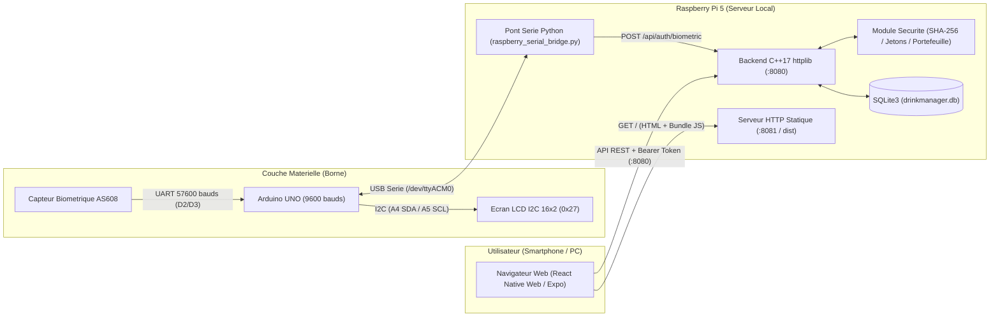
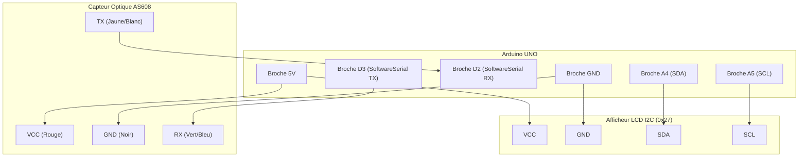
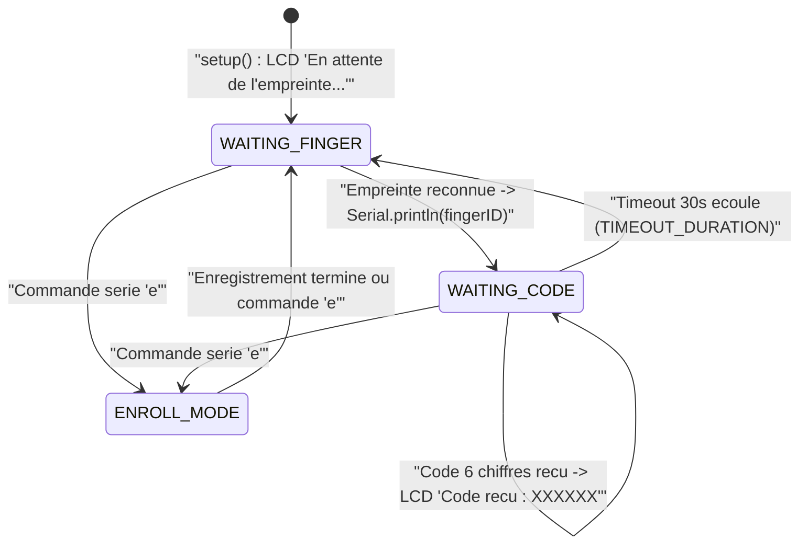
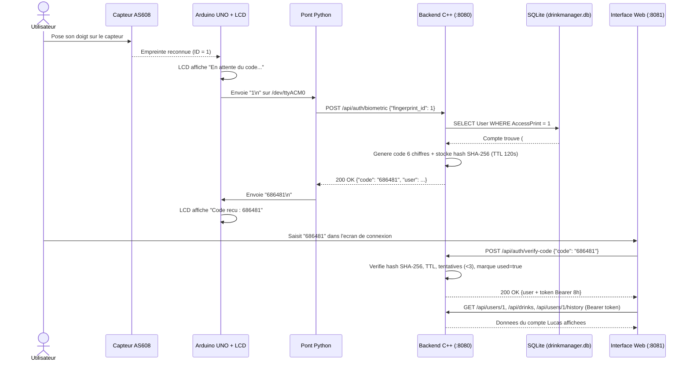
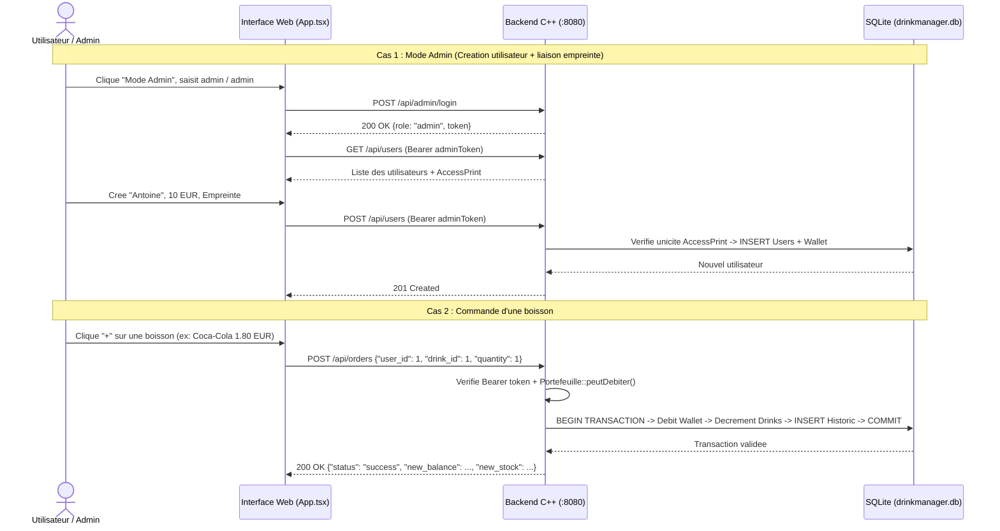
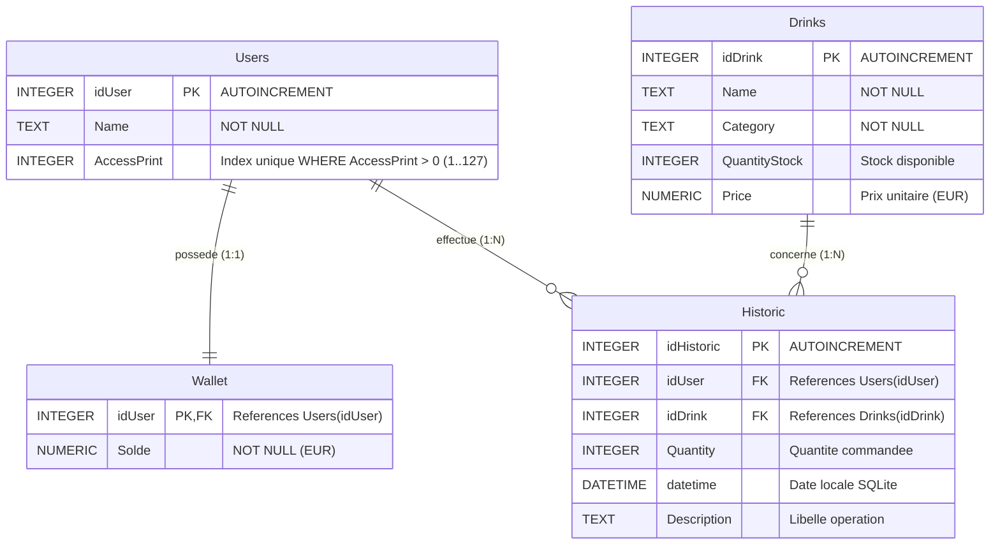

# ☕ Drink Manager — Borne Connectée Biométrique (BTS CIEL)

Système complet de gestion et de distribution de boissons associant **électronique embarquée (Arduino UNO + capteur d'empreintes AS608 + écran LCD I2C)**, **supervision Raspberry Pi (pont série Python + serveur API REST C++17 + base SQLite)** et **interface web mobile-first (React Native Web / Expo)** accessible par QR Code sur le réseau local.

> 📄 **Documents complémentaires :**
> - [Tutoriel Déploiement Raspberry Pi 5](TUTO_RASPBERRY_PI.md)
> - [Documentation Module Biométrique AS608](arduino/documentation_technique_module_biom_trique.md)

---

## Sommaire

1. [Vue d'ensemble et fonctionnalités](#1-vue-densemble-et-fonctionnalités)
2. [Schémas complets du système](#2-schémas-complets-du-système)
   - [Architecture globale](#21-architecture-globale-matériel--logiciel)
   - [Câblage matériel Arduino UNO / AS608 / LCD I2C](#22-câblage-matériel-arduino-uno--as608--lcd-i2c)
   - [Machine à états du firmware Arduino](#23-machine-à-états-du-firmware-arduino)
   - [Séquence d'authentification biométrique (code 6 chiffres)](#24-séquence-dauthentification-biométrique-code-6-chiffres)
   - [Séquence commande de boisson & Mode Admin](#25-séquence-commande-de-boisson--mode-admin)
   - [Modèle Conceptuel de Données (SQLite)](#26-modèle-conceptuel-de-données-sqlite)
3. [Arborescence du projet](#3-arborescence-du-projet)
4. [Protocole d'installation complet (de A à Z)](#4-protocole-dinstallation-complet-de-a-à-z)
   - [Étape A — Matériel et Arduino UNO](#étape-a--matériel-et-arduino-uno)
   - [Étape B — Préparation du Raspberry Pi](#étape-b--préparation-du-raspberry-pi)
   - [Étape C — Installation et compilation du Backend C++](#étape-c--installation-et-compilation-du-backend-c)
   - [Étape D — Installation du Pont Série Python](#étape-d--installation-du-pont-série-python)
   - [Étape E — Build et déploiement de l'Interface Web](#étape-e--build-et-déploiement-de-linterface-web)
   - [Étape F — Installation sur PC Windows (développement local)](#étape-f--installation-sur-pc-windows-développement-local)
5. [Lancement rapide et utilisation](#5-lancement-rapide-et-utilisation)
6. [Référence de l'API REST C++ (port 8080)](#6-référence-de-lapi-rest-c-port-8080)
7. [Sécurité et tests](#7-sécurité-et-tests)
8. [Dépannage rapide](#8-dépannage-rapide)

---

## 1. Vue d'ensemble et fonctionnalités

- **Authentification biométrique obligatoire** : aucune session n'est accessible par URL (`?user_id=` bloqué). L'utilisateur pose son doigt sur le capteur AS608 de la borne ; un code temporaire à **6 chiffres** (valable **2 minutes**, **usage unique**, bloqué après **3 essais faux**) s'affiche sur l'écran LCD I2C de l'Arduino et doit être saisi sur le site web.
- **Mode Administrateur (`admin` / `admin`)** : accessible depuis l'écran de connexion web pour créer un nouveau compte, lui associer un numéro d'empreinte (`1..127`), consulter la liste des utilisateurs et modifier l'empreinte liée à un compte existant (avec contrôle anti-doublon `409 Conflict`).
- **Portefeuille & Catalogue en temps réel** : consultation du solde, rechargement rapide (`+2 €`, `+5 €`, `+10 €`, `+20 €`) ou personnalisé (plafonds `100 €` par recharge / `500 €` de solde max gérés en centimes), recherche et filtrage des boissons par catégorie, commande transactionnelle atomique (débit portefeuille + décrément stock + historique).
- **Historique & Export XML** : consultation des achats du compte connecté et génération d'un export XML côté backend C++.
- **Script de démarrage tout-en-un** : `lancer_drink_manager.sh` lance, supervise et arrête proprement les 3 services (Backend C++ `:8080`, Interface Web `:8081`, Pont Série Arduino).

---

## 2. Schémas complets du système

### 2.1 Architecture globale (Matériel + Logiciel)



### 2.2 Câblage matériel Arduino UNO / AS608 / LCD I2C



| Composant | Broche Composant | Broche Arduino UNO | Protocole / Rôle |
|---|---|---|---|
| **AS608** | `VCC` (Rouge) | `5V` | Alimentation 5 V |
| **AS608** | `GND` (Noir) | `GND` | Masse commune |
| **AS608** | `TX` (Jaune/Blanc) | `D2` | Émission capteur -> `SoftwareSerial` RX (57600 bauds) |
| **AS608** | `RX` (Vert/Bleu) | `D3` | Réception capteur <- `SoftwareSerial` TX (57600 bauds) |
| **LCD I2C** | `VCC` | `5V` | Alimentation 5 V |
| **LCD I2C** | `GND` | `GND` | Masse commune |
| **LCD I2C** | `SDA` | `A4` | Données I2C (adresse `0x27`, 16x2) |
| **LCD I2C** | `SCL` | `A5` | Horloge I2C |
| **USB** | Port USB-B | USB Raspberry Pi | Liaison série `/dev/ttyACM0` (9600 bauds) |

### 2.3 Machine à états du firmware Arduino



### 2.4 Séquence d'authentification biométrique (code 6 chiffres)



### 2.5 Séquence commande de boisson & Mode Admin



### 2.6 Modèle Conceptuel de Données (SQLite)



---

## 3. Arborescence du projet

```text
projet/
├── README.md                                  # Documentation principale & protocole d'installation
├── TUTO_RASPBERRY_PI.md                       # Guide pas-à-pas Raspberry Pi 5
├── lancer_drink_manager.sh                    # Script tout-en-un (Backend + Web + Pont Série)
│
├── arduino/
│   ├── documentation_technique_module_biom_trique.md
│   ├── FingerPrint/
│   │   ├── enroll/enroll.ino                  # Sketch d'enrôlement des empreintes (1..127)
│   │   └── fingerprint/fingerprint.ino        # Sketch de lecture simple
│   └── lecteur_empreinte/
│       └── lecteur_empreinte.ino              # Sketch final utilisé (AS608 + LCD I2C + mode 'e')
│
├── backend/
│   ├── CMakeLists.txt                         # Build CMake (drink_manager + test_securite)
│   ├── data/
│   │   ├── drinkmanager.db                    # Base SQLite (30 Users, 30 Wallet, 25 Drinks, 13 Historic)
│   │   └── drinkmanager.db.bak                # Sauvegarde initiale de la BDD
│   ├── include/
│   │   └── httplib.h                          # Serveur HTTP C++17 single-header
│   ├── scripts/
│   │   └── raspberry_serial_bridge.py         # Pont série USB Arduino <-> API C++
│   ├── sqlite/
│   │   ├── sqlite3.c
│   │   └── sqlite3.h
│   ├── src/
│   │   ├── main.cpp                           # Serveur REST, sessions, routes API & Mode Admin
│   │   ├── auth/securite/                     # Authentificateur, jetons OTP SHA-256, Portefeuille
│   │   ├── materiel/protocole.{h,cpp}         # Parseur de trames série & générateur de commandes
│   │   └── repositories/UserRepository.{hpp,cpp} # ORM SQLite + transactions + export XML
│   └── tests/securite/main.cpp                # Suite de tests unitaires sécurité
│
├── drink-manager-web/
│   ├── app.json                               # Configuration Expo Web (bundler Metro)
│   ├── package.json                           # Dépendances React 19 / Expo 58 / Axios
│   ├── tsconfig.json
│   ├── App.tsx                                # UI complète (Login biométrique, Mode Admin, Carte, Historique)
│   └── src/
│       ├── types.ts                           # Types TypeScript (UserProfile, Drink, HistoryItem...)
│       └── services/api.ts                    # Client Axios + gestion sessionStorage & Bearer token
│
└── docs/
    ├── DiagramProjectLink.png                 # Diagramme de liaison du projet
    └── notes_yohan.md                         # Notes d'avancement matériel
```

---

## 4. Protocole d'installation complet (de A à Z)

### Étape A — Matériel et Arduino UNO

1. **Réaliser le câblage** selon le tableau de la [section 2.2](#22-câblage-matériel-arduino-uno--as608--lcd-i2c) (AS608 sur `5V`, `GND`, `D2`, `D3` et LCD I2C sur `5V`, `GND`, `A4`, `A5`).
2. **Installer les bibliothèques** dans l'IDE Arduino (*Croquis -> Inclure une bibliothèque -> Gérer les bibliothèques*) :
   - `Adafruit Fingerprint Sensor Library`
   - `LiquidCrystal I2C` (adresse `0x27`, 16x2)
3. **Enrôler les empreintes** :
   - Soit avec [enroll.ino](arduino/FingerPrint/enroll/enroll.ino), soit directement dans [lecteur_empreinte.ino](arduino/lecteur_empreinte/lecteur_empreinte.ino) en ouvrant le Moniteur Série à `9600` bauds, en envoyant **`e`** puis l'ID souhaité (`1` à `127`).
   - L'ID mémorisé dans le capteur doit correspondre à la colonne `AccessPrint` de l'utilisateur dans la BDD (par défaut, les utilisateurs `#1` à `#30` ont `AccessPrint = 1..30`, ou bien utilisez le **Mode Admin** sur le site web pour lier un nouvel ID).
4. **Téléverser le firmware final** : [lecteur_empreinte.ino](arduino/lecteur_empreinte/lecteur_empreinte.ino) sur l'Arduino UNO, puis brancher l'Arduino en USB sur le Raspberry Pi.

---

### Étape B — Préparation du Raspberry Pi

1. Flasher **Raspberry Pi OS (64-bit)** via Raspberry Pi Imager (SSH activé).
2. Se connecter en SSH et installer les paquets requis :
   ```bash
   sudo apt update && sudo apt upgrade -y
   sudo apt install -y git build-essential cmake python3 python3-serial curl
   ```
3. Installer **Node.js 22 LTS** (requis par Expo pour compiler l'interface web) :
   ```bash
   curl -fsSL https://deb.nodesource.com/setup_22.x | sudo -E bash -
   sudo apt install -y nodejs
   node -v   # doit afficher v22.x.x
   ```
4. Autoriser l'utilisateur courant à lire le port série USB (`dialout`), puis se reconnecter en SSH :
   ```bash
   sudo usermod -aG dialout $USER
   ```
5. Cloner le dépôt et vérifier le port USB de l'Arduino :
   ```bash
   git clone https://github.com/antoinefoucher1111-hub/BTS-CIEL---DRINK-MANAGER.git ~/BTS-CIEL---DRINK-MANAGER
   ls /dev/ttyACM* /dev/ttyUSB*
   ```

---

### Étape C — Installation et compilation du Backend C++

```bash
cd ~/BTS-CIEL---DRINK-MANAGER/projet/backend
mkdir -p build && cd build
cmake ..
make -j"$(nproc)"
```

Vérifier les tests unitaires de sécurité et le démarrage de l'API :
```bash
./test_securite
cd ..
./build/drink_manager
```
Sortie attendue :
```text
[OK] Tous les tests du module securite ont reussi.
[INFO] Base data/drinkmanager.db ouverte avec succes.
[INFO] Serveur actif sur http://0.0.0.0:8080
```

---

### Étape D — Installation du Pont Série Python

Vérifier que `pyserial` est disponible (déjà installé via `python3-serial`, sinon `pip install pyserial`), puis tester le pont avec le backend lancé :
```bash
# Test sans capteur physique (simule l'empreinte #1 -> Lucas)
python3 ~/BTS-CIEL---DRINK-MANAGER/projet/backend/scripts/raspberry_serial_bridge.py --test-id 1

# Lancement réel avec l'Arduino branché sur /dev/ttyACM0
python3 ~/BTS-CIEL---DRINK-MANAGER/projet/backend/scripts/raspberry_serial_bridge.py --port /dev/ttyACM0
```

> **Important :** fermer **Thonny** ou le **Moniteur Série Arduino** avant de lancer le pont, sinon le port `/dev/ttyACM0` est verrouillé.

---

### Étape E — Build et déploiement de l'Interface Web

```bash
cd ~/BTS-CIEL---DRINK-MANAGER/projet/drink-manager-web
npm install
npx expo export --platform web
python3 -m http.server 8081 --directory dist
```

L'interface est accessible depuis n'importe quel appareil du même réseau à l'adresse `http://<IP_DU_PI>:8081` (le frontend détecte automatiquement l'hôte courant via `window.location.hostname` pour contacter l'API sur `:8080`).

---

### Étape F — Installation sur PC Windows (développement local)

1. **Compiler le backend C++ (PowerShell avec `g++` MinGW ou CMake)** :
   ```powershell
   cd C:\Users\antoi\Documents\Ui_Interface_web\projet\backend
   mkdir build -Force
   gcc -O2 -c sqlite\sqlite3.c -o build\sqlite3.o
   $cpps = Get-ChildItem -Path src -Recurse -Filter *.cpp | ForEach-Object { $_.FullName }
   g++ -std=c++17 -O2 -D_WIN32_WINNT=0x0a00 -Iinclude -Isrc -Isqlite $cpps build\sqlite3.o -o build\drink_manager.exe -lws2_32 -lcrypt32
   ```
2. **Lancer le backend (avec simulateur de test autorisé si pas d'Arduino)** :
   ```powershell
   $env:DM_ALLOW_SIM = "1"
   .\build\drink_manager.exe
   ```
3. **Exporter / lancer l'interface web** :
   ```powershell
   cd C:\Users\antoi\Documents\Ui_Interface_web\projet\drink-manager-web
   npm install
   npx expo export --platform web
   python -m http.server 8081 --directory dist
   ```
   Ouvrir `http://localhost:8081`.

---

## 5. Lancement rapide et utilisation

### Démarrage en 1 commande sur Raspberry Pi

```bash
cd ~/BTS-CIEL---DRINK-MANAGER/projet
chmod +x lancer_drink_manager.sh
./lancer_drink_manager.sh
```

Le script [lancer_drink_manager.sh](lancer_drink_manager.sh) :
1. Nettoie proprement d'éventuels anciens processus sur les ports `8080`/`8081`.
2. Compile le backend ou génère `dist/` si absents, puis démarre `drink_manager` (`:8080`) et le serveur HTTP web (`:8081`).
3. Affiche l'URL exacte `http://<IP_PI>:8081` et lance le pont série Arduino au premier plan.
4. Coupe tous les processus proprement sur **`Ctrl + C`**.

### Variables d'environnement optionnelles (Backend C++)

| Variable | Défaut | Rôle |
|---|---|---|
| `DM_ALLOW_SIM` | non défini (`0`) | Si `1`, autorise les appels distants vers `POST /api/auth/biometric` pour le simulateur web de test. **Ne pas activer en production.** |
| `DM_ADMIN_USER` | `admin` | Identifiant du Mode Admin. |
| `DM_ADMIN_PASS` | `admin` | Mot de passe du Mode Admin. |

---

## 6. Référence de l'API REST C++ (port 8080)

| Méthode & Route | Accès requis | Description |
|---|---|---|
| `GET /api/health` | Public | État du serveur et chemin de la base SQLite |
| `POST /api/auth/biometric` | Localhost (`127.0.0.1`) ou `DM_ALLOW_SIM=1` | Reçoit `fingerprint_id` ou `serial_line` (`USER:<id>`), génère le code OTP 6 chiffres |
| `POST /api/auth/verify-code` | Public (code 6 chiffres requis) | Vérifie le code, crée et retourne le jeton `Bearer` (8 h) + profil utilisateur |
| `POST /api/admin/login` | Public (identifiants admin) | Authentifie le Mode Admin et retourne un jeton admin `Bearer` (8 h) |
| `GET /api/users` | Admin ou Localhost | Liste tous les utilisateurs (`id`, `name`, `balance`, `access_print`) |
| `POST /api/users` | Admin ou Localhost | Crée un utilisateur + portefeuille + empreinte (`409` si empreinte déjà prise) |
| `PUT /api/users/:id/fingerprint` | Admin ou Localhost | Associe/modifie `access_print` (`0..127`, `409` si doublon) |
| `GET /api/users/:id` | Bearer utilisateur (`id == token.userId`) | Retourne le profil de l'utilisateur connecté (`401`/`403` sinon) |
| `PUT /api/users/:id` | Bearer utilisateur (`id == token.userId`) | Met à jour le nom du profil connecté |
| `GET /api/drinks` | Bearer utilisateur | Liste le catalogue des boissons, prix et stocks |
| `POST /api/orders` | Bearer utilisateur (`user_id == token.userId`) | Passe une commande transactionnelle (débit + stock - `quantity` + `Historic`) |
| `POST /api/recharge` | Bearer utilisateur (`user_id == token.userId`) | Crédite le portefeuille (max `100.00 €` / opération, solde max `500.00 €`) |
| `GET /api/users/:id/history` | Bearer utilisateur (`id == token.userId`) | Retourne les 50 dernières opérations du compte |
| `GET /api/history/xml` | Bearer utilisateur | Exporte en XML (`application/xml`) l'historique du compte connecté |

---

## 7. Sécurité et tests

- **Hachage SHA-256** (`picosha2.h`) : les codes à 6 chiffres générés par `Securite::genererCode()` ne sont stockés qu'en version hachée dans `BaseRepository`.
- **Jetons OTP éphémères** (`GestionJeton`) : durée de vie **120 s**, **usage unique** (`used = true` dès validation), blocage après **3 tentatives incorrectes**.
- **Isolation des comptes** : toutes les routes utilisateur exigent `Authorization: Bearer <token>` et renvoient `401` sans jeton ou `403` si l'ID demandé diffère du compte authentifié.
- **Calcul monétaire entier en centimes** (`Portefeuille`) : évite les erreurs d'arrondi flottant et empêche les débordements d'entiers.
- **Tests validés** :
  - `test_securite.exe` : `[OK] Tous les tests du module securite ont reussi.` (SHA-256, OTP, expiration 120s, blocage 3 essais, calcul portefeuille).
  - Tests end-to-end API + Pont Python + Mode Admin : validation `401` mauvais mot de passe admin, `200` login admin, `409` doublon empreinte, `201` création utilisateur + empreinte, `200` scan `--test-id` + `/api/auth/verify-code` + `GET /api/users/:id`.
  - Build Web Expo : `npx expo export --platform web` génère `dist/index.html` et le bundle JS sans erreur.

---

## 8. Dépannage rapide

| Problème constaté | Cause probable | Solution |
|---|---|---|
| `Code inconnu ou expire` sur le site web | `test.py` (codes aléatoires locaux) tourne à la place de `raspberry_serial_bridge.py`, ou le code a > 2 min | Utiliser `./lancer_drink_manager.sh` ou `raspberry_serial_bridge.py` |
| `Port serie indisponible (/dev/ttyACM0)` | Thonny / Moniteur Série ouvert, ou port différent (`/dev/ttyUSB0`) | Fermer Thonny, vérifier `ls /dev/ttyACM* /dev/ttyUSB*`, ou passer le port en argument |
| `OSError: [Errno 98] Address already in use` | Un ancien serveur HTTP tourne déjà sur `8081` | Lancer `fuser -k 8081/tcp` ou utiliser `./lancer_drink_manager.sh` |
| `CommandError: No platforms are configured...` lors de `expo export` | Commande lancée hors de `drink-manager-web/` ou `app.json` absent | Vérifier `cd drink-manager-web` et présence de `app.json` |
| `Node.js (v20.x) is outdated...` | Version Node trop ancienne sur le Raspberry Pi | Installer Node.js 22 LTS (voir [Étape B](#étape-b--préparation-du-raspberry-pi)) |
