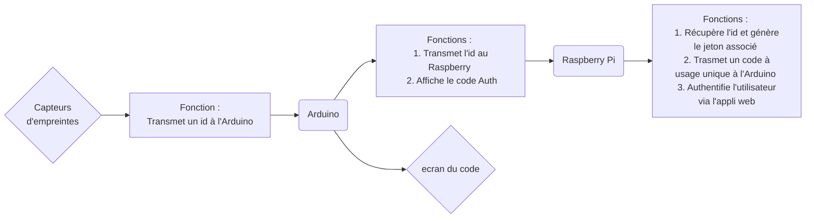

# Package Sécurité

But du package est de faire la sécurité entre le rasp pi et l'arduino pour communiquer le lecteur d'empreinte.

Ce package tourne sur le Pi.

L'arduino donne un ID (finger print id) -> appelle surUtilisateurIdentifie à l'authentificateur.
reste à faire : package matériel :

auth test => lien arduino

TO DO :

- [ ] Vérifier unicité du code généré.
- [ ] Vérifier la similarité du code généré et entré dans l'application web

## Principe de fonctionnement

L'id doit référer à un utilisateur en base, lié par un jeton temporaire : jeton = fingerId + timestamp + code unique.

Le raspberry fait les calculs de hashage.
